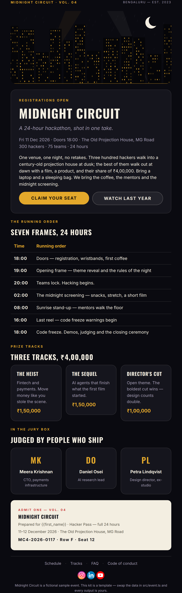
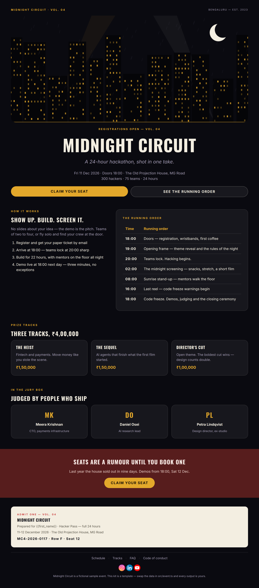
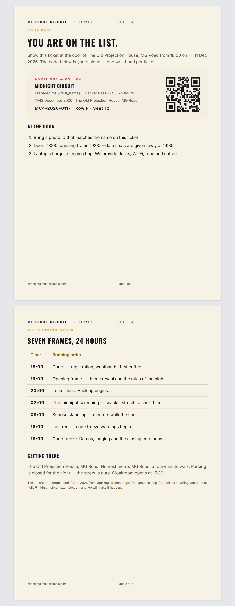
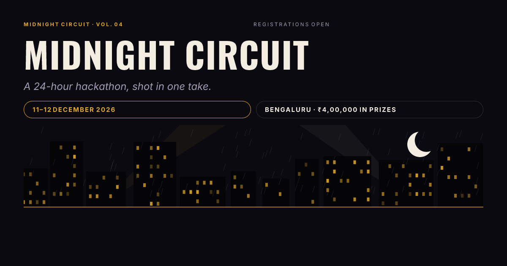

# Midnight Circuit — a hackathon event kit for Hyper Elements

**One event. One theme. One shared set of components. Four finished outputs.**

Midnight Circuit is a fictional 24-hour hackathon ("a hackathon, shot in one take").
This kit announces it everywhere an organiser has to show up — with a single
Hyper Elements theme and a single data file:

| Output | Root | File |
| --- | --- | --- |
| Invitation email (+ plain text) | `<Email>` | `out/invite.html`, `out/invite.txt` |
| Web announcement page | `<Page>` | `out/page.html` |
| E-ticket (print HTML + real PDF) | `<Document>` | `out/ticket.html`, `out/ticket.pdf` |
| Social / Open Graph card (1200×630 PNG) | `<Canvas>` | `out/social-card.png` |
| Hero art (1200×540 PNG, drawn in code) | `<Canvas>` | `out/hero.png` |
| Email-client previews (Outlook, Gmail, Apple Mail…) | emulator | `out/clients/*.html` |

Change the event in **`src/event.ts`** — name, dates, schedule, tracks, judges,
ticket — and every output above follows. Nothing is edited twice.



## The look

Two of the organiser's house styles, mixed:

- **Cinematic / film noir** — near-black ground, warm bone text, one marquee-amber
  accent, a single crimson reserved for the ticket stub; condensed Oswald
  headlines with letterspaced kickers; the copy is written like a film programme
  ("Seven frames, 24 hours", "The running order").
- **Glassmorphism** — every content card is frosted glass: a translucent white
  surface with a 1px light border floating on the dark ground. On the web page
  and the PNG card it is true translucency; in email the theme's `formats.email`
  override swaps it for a solid near-black tint, because email clients drop
  rgba cell backgrounds.

The hero art is not a stock photo: it is a noir skyline — rooftops, lit windows,
searchlight beams, rain, a crescent moon — drawn with Hyper Elements `Svg`
shapes from a seeded random generator (so it never changes between renders),
rendered once from a `<Canvas>` to PNG, and then reused as the `<Image>` hero
in the email and the page.

## How Hyper Elements is used

This kit leans on the parts of Hyper Elements that only exist because one tree
can become many formats:

- **One theme, every root.** `defineTheme` in `src/theme.ts` ("Noir Marquee")
  carries the palette, the Oswald/Inter type scale, Button defaults + a `ghost`
  variant, and named styles (`glass`, `kicker`, `ticket`). The same theme is
  passed to `Email`, `Page`, `Document` and `Canvas`.
- **`extendTheme` for print.** The ticket uses `noirMarqueePrint`, an extended
  theme on bone paper with dark ink — one brand, two stocks.
- **Per-format overrides.** `formats.email` restyles the glass cards for email
  clients only; a `Section` with a `tokens` override makes the page's crimson
  call-to-action band without touching the theme.
- **Shared components, not copies.** `src/components.tsx` — masthead, schedule
  `Table`, prize-track `Grid`, judges `Row`, paper `TicketBlock`, footer with
  `Menu` + `Social` — is rendered inside all four roots unchanged.
- **Drawn, not photographed.** `Svg` shapes draw the skyline (Canvas art) and
  the ticket's scannable-style code, generated from the ticket number
  (Svg is not an email element, so the email shows the code as text instead —
  the outline below makes that difference visible).
- **Merge tags.** The ticket is "Prepared for `{{first_name}}`" via `MergeTag`,
  ready for any sending service.
- **The agent feedback loop, used for real.** Every template is `validate()`d;
  the email is also validated with the `@hyper-elements/email-clients` plugin
  and previewed in Outlook, Gmail and Apple Mail with `renderInEmailClients()`
  (`out/clients/`). `outline()` output for the email is quoted in the render
  log (`out/render-log.txt`).
- **All four renderers.** `render()` (email HTML + text, page HTML, print HTML),
  `renderImage()` (hero + social card PNGs) and `renderPdf()` (the ticket PDF)
  run in one script.

### What validation caught

- `justifyContent: "space-between"` is not possible in email — the masthead
  and ticket rows were rebuilt on widths + `flex`, so the email lines up the
  same as the page.
- The first email build was **125 KB** because the hero PNG was inlined as a
  data URI — over Gmail's 100 KB clip limit. The shipping email now references
  the hosted hero (`out/hero.png`, host it next to the HTML) and weighs
  **33.8 KB**. The client previews in `out/clients/` intentionally use an
  inlined copy so each preview file is self-contained; that is the one
  remaining `email/size` warning in the log, and it is expected.
- Everything else is info-level client notes (classic Outlook draws square
  corners and keeps, but does not render, letter-spacing) — the design was
  chosen to degrade gracefully under exactly those notes.

## Run it

```bash
npm install
npm run build        # renders everything into out/, then screenshots/
# or separately:
npm run render       # out/invite.html, page.html, ticket.pdf, social-card.png, clients/…
npm run screenshot   # screenshots/email.png, page.png, ticket.png (needs a Chromium)
```

- Fonts are bundled in `assets/fonts/` (Inter, Oswald, Noto Sans — all OFL)
  because the image and PDF renderers load no fonts themselves. Noto Sans is
  the fallback for glyphs the Inter subset lacks (e.g. ₹).
- `src/screenshot.tsx` uses `playwright-core` with a local Chromium
  (`CHROMIUM_PATH` overrides the path). The `Social` icons are served by
  Unlayer's CDN; the screenshot script serves those exact CDN bytes locally
  because this sandbox's Chromium cannot use the authenticated proxy — the
  shipped HTML is untouched.
- No live deployment is needed: open `out/page.html` or `out/invite.html` in
  any browser.

## Make it yours

1. Edit `src/event.ts` (the only file with event facts).
2. Re-skin in `src/theme.ts` — palette, fonts, the `glass`/`ticket` styles.
3. Re-run `npm run build`. Email, page, PDF and card are all re-issued.

## The other outputs







## Credits

Built with [Hyper Elements](https://github.com/hyper-elements/hyper-elements)
(`@hyper-elements/react`, `@hyper-elements/email-clients`). Midnight Circuit is
a fictional event; any resemblance to a real hackathon at a century-old
projection house is purely aspirational. MIT licensed.
